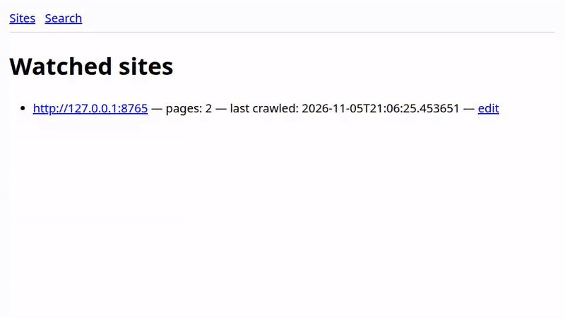

# webcrawler



Watch the websites you pick, keep every version of every page, and search the whole history.

```bash
git clone https://github.com/jayhemnani9910/webcrawler.git && cd webcrawler && pip install -r requirements.txt
```

[](https://github.com/jayhemnani9910/webcrawler/actions/workflows/ci.yml)

In the GIF I crawled a three-page test site on localhost, changed a price on the menu page from 4 to 6 dollars, and crawled again. The search for "sourdough" finds both versions.

## Usage

```bash
python -m src.main add-site https://example.com   # find pages from the sitemap and homepage links
python -m src.main run                            # crawl now, then every 2 hours (Ctrl-C to stop)
python -m src.main status                         # sites, page counts, last crawl
python -m src.main search "query"                 # full-text search over every stored version
python -m src.main web                            # web UI on http://127.0.0.1:1212
```

Data goes to `watcher.db` in the repo root. Set `WPS_DB_PATH` to put it somewhere else. `.env.example` lists every variable the code reads.

To run the web UI in Docker instead:

```bash
docker build -t webcrawler . && docker run --rm -p 1212:1212 webcrawler
```

## How it works

1. `add-site` reads `robots.txt`, `/sitemap.xml` and `/sitemap_index.xml`, and up to 30 same-site links from the homepage. Links to `/login`, `/admin`, `/signup` and `/search` are skipped.
2. Each crawl asks ArchiveBox (`archivebox add`) to snapshot the page and reads the HTML back from its index. If ArchiveBox isn't installed or has nothing, it fetches the page directly with `If-Modified-Since`.
3. Pages that `robots.txt` disallows are skipped, and page fetches wait out the site's `Crawl-delay` (1 second if none).
4. readability-lxml pulls out the main text, and the text is hashed with SHA-256. Same hash as last time means no new version.
5. A changed page gets a new row in `PageVersions`, and the added and removed lines go into `Changes`, with any new image URLs.
6. Each version is signed with Ed25519 (PyNaCl, key in `keys/`), or with AWS KMS or Vault if configured, and gets a Merkle root over the previous and current hash.
7. The hash is timestamped with OpenTimestamps if the `ots` CLI or `OTSD_URL` is available. Otherwise a plain local anchor file is written to `anchors/`.
8. Text goes into a SQLite FTS5 index. Search ranks with bm25 and returns highlighted snippets.

## Web UI and API

| Route | What it does |
|-------|--------------|
| `/` | Watched sites with page counts and last crawl time |
| `/site/<id>` | Pages of a site and how many versions each has |
| `/site/<id>/edit` | Turn a site on or off, set its user agent and crawl delay |
| `/search` | Search with site and month facets, paginated |
| `/api/search?q=` | Same search as JSON |
| `/health` | `{"status": "ok"}` when the database answers |
| `/metrics` | Prometheus metrics (a search request counter) |
| `/admin/*` | Counts and crisis mode, behind the `X-Admin-Token` header. Off unless `WPS_ADMIN_TOKEN` is set |

[docs/API.md](docs/API.md) has every route, including the experimental Merkle sync endpoints (`/api/merkle/push`, `/api/merkle/pull`).

## Running it on a schedule

`systemd/` has a service and a timer that fires every 2 hours. `sudo ./install_service.sh` installs both, creates a `website-watcher` user and keeps data in `/var/lib/website-watcher`. `CRON.md` has a crontab line if you'd rather use cron.

`scripts/backup_db.sh` writes a gzipped SQL dump of the database to `backups/`.

## Tests

```bash
pip install pytest ruff
ruff check .
pytest -q
```

CI runs the same on Python 3.10 and 3.11. Tests use a temporary database, never `watcher.db`.

## Project layout

```
src/
  main.py                  CLI and scheduler
  crawler.py               discovery, robots.txt, crawl loop, change detection
  archivebox_interface.py  calls the archivebox CLI and reads its index
  db.py                    SQLite schema and FTS5 search
  ui.py                    Flask web UI and API
  crypto_asym.py           Ed25519 signing, KMS or local keys
  anchor.py, anchor_ots.py OpenTimestamps or local anchor files
  merkle*.py, gossip*.py, p2p.py  experimental multi-node sync
systemd/                   service and timer
tests/
```

## Contributing

See [CONTRIBUTING.md](CONTRIBUTING.md).

## License

MIT, see [LICENSE](LICENSE).
